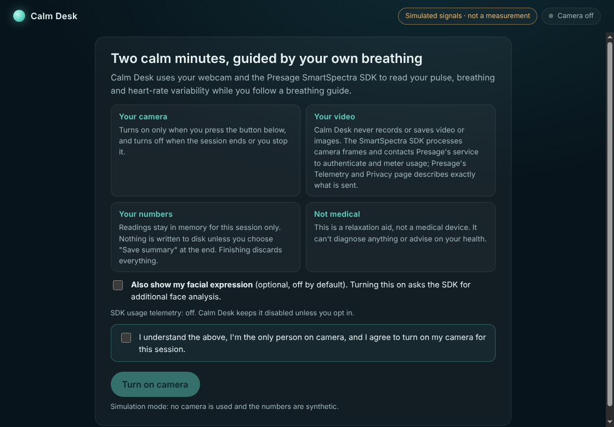
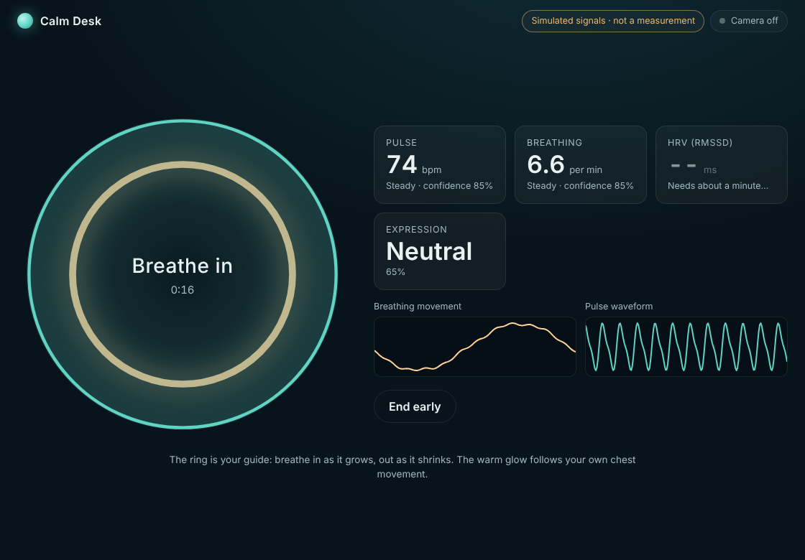
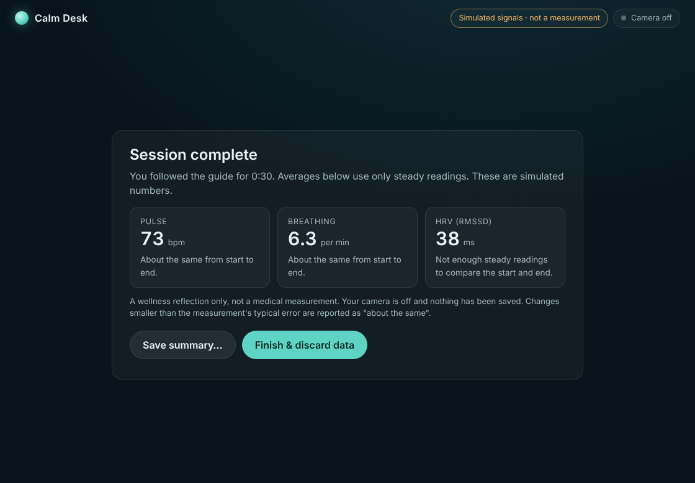

# Calm Desk

**A consent-first guided breathing session that responds to your live pulse, breathing and HRV, read from your webcam with the [Presage SmartSpectra SDK](https://physiology.presagetech.com/).**

Built for the Presage SmartSpectra SDK Challenge (`#presagechallenge`). Calm Desk is a small Electron desktop app: you follow a breathing ring for two minutes while the SDK reads your vitals from the camera. The warm glow around the ring follows *your own chest movement*, so the guide is verified against your real breathing rather than just a timer. At the end you get a plain-language summary you can save or discard.

| Consent | Live session | Summary |
| --- | --- | --- |
|  |  |  |

> These screenshots were captured in `--simulate` mode (synthetic signals, no camera). The app shows a "Simulated signals" badge whenever it is running that way. The demo video shows the live camera.

## Live Presage signals used

| Signal | SDK field | Used for |
| --- | --- | --- |
| Pulse rate | `cardio.pulseRate` | Live tile, summary |
| Pulse waveform | `cardio.arterialPressureTrace` | Live chart |
| HRV (RMSSD) | `cardio.hrv` | Live tile, summary |
| Breathing rate | `breathing.rate` | Live tile, summary |
| Breathing movement | `breathing.upperTrace` | Drives the warm glow ring and a live chart |
| Facial expression (opt-in) | `face.expression` | Optional tile |

Readings flagged `stable` by the SDK are shown as "Steady"; others are dimmed and labelled "Settling…". The summary only averages stable readings, and it only calls a start-to-end change a *change* if it is larger than the SDK's documented accuracy for that signal (±3 bpm pulse, ±1 breath/min, ±5 ms HRV). Smaller differences are reported as "about the same".

## Setup

**Requirements:** Node.js 20+ (Node 22+ to run `npm test`; the SDK recommends Node 24 LTS), a webcam, and an API key from [physiology.presagetech.com](https://physiology.presagetech.com/). Supported platforms are those of the SDK's native runtime: macOS Apple Silicon, Linux x64/arm64 (glibc 2.35+), Windows x64.

```bash
git clone https://github.com/SenalDilanka/calm-desk.git
cd calm-desk
npm install            # also downloads the SDK's native runtimes for every platform (a few hundred MB)
cp .env.example .env   # then put your key in SMARTSPECTRA_API_KEY
npm start
```

**No key or camera yet?** `npm run simulate` runs the whole app on synthetic signals so you can explore the UI. The signals are built with the SDK's own protobuf classes and flow through the same decode path as live data, and a badge on screen says they are simulated.

**For judges:** there is no login. You need a SmartSpectra API key (the free trial is enough) in `.env`, then `npm start`. A flag `--session-seconds=30` shortens the session for quick testing: `npm start -- --session-seconds=30`.

## Consent and Data Handling

| Topic | What Calm Desk does |
| --- | --- |
| **Camera consent** | The camera is off at launch. It opens only after you tick an explicit consent box (which includes "I'm the only person on camera") and press **Turn on camera**. Consent is asked every session and is never remembered. |
| **Camera permission scope** | The app grants camera access to its own bundled page only, for **video only** (no microphone), and denies every other permission request. The app shows a "Camera on / off" indicator, and the operating system's camera indicator applies too. |
| **When the camera turns off** | When the session ends, when you press **End early** or **Turn camera off**, when you close the window, and **immediately if the SDK reports any error**. |
| **Video and images** | Calm Desk's own code never records, saves, uploads or screenshots video or images. Frames are handed only to the SmartSpectra SDK, in-process, over a local message channel between the app's window and its main process. |
| **What the SDK sends to Presage** | The SDK is not a local-only library. In this project's testing, its logs showed it contacting Presage's service for **authorization / usage verification**, **device pairing** and **model delivery**. Exactly what the SDK transmits is defined by Presage. Please read Presage's *Telemetry and Privacy* documentation (linked from the SmartSpectra docs and the challenge page) before relying on any claim here beyond what Calm Desk's own code does. |
| **SDK telemetry** | The SDK's aggregate usage telemetry (`enableTelemetry`) defaults to **on** in the SDK. Calm Desk turns it **off** unless you opt in with `SMARTSPECTRA_TELEMETRY=1`. This covers the SDK's optional telemetry only; authorization and usage metering still happen because the SDK needs them to work. |
| **Signals requested** | Only what the app displays: the breathing and cardio groups always, and the **face group only if you tick the optional expression box**. EDA and micromotion are never requested. Note that the SDK's face group also covers landmarks, blinking and talking detection, which Calm Desk requests as part of that group but never displays or stores. |
| **AI services** | **None.** Calm Desk never calls the SDK's `requestInsight` (LLM Insights) and uses no other AI or third-party service. |
| **Storage and retention** | Readings live in memory for the session only, in bounded rolling buffers. **Nothing is written to disk by default.** The one exception is the **Save summary…** button, which opens a native save dialog and writes a small JSON file of *aggregate numbers only* (means, start-to-end change, counts) to the place you choose. It contains no video, no waveforms and no expression data. |
| **Sharing** | Calm Desk shares nothing with anyone. The only network traffic is the SDK's own, described above. |
| **Deletion** | **Finish & discard data** clears every reading held in memory and returns to the consent screen. Closing the app also drops everything. A file you chose to save is yours to delete. The SDK pre-creates a small directory under the operating system's app-cache path for its own initialization; Calm Desk does not write into it. |
| **API key** | Read from the environment or a git-ignored `.env` file in the main process. It is never logged, never written to disk by the app, and never included in saved summaries. |
| **Covert or non-consensual monitoring** | Designed against: no background or automatic capture, a visible consent step that asks that only the user is on camera, an always-visible camera indicator, and a prompt if more than one face is in view. |

### Responsible-use boundaries

Calm Desk is a relaxation aid, **not a medical device**. It makes no diagnosis or treatment claims and gives no health advice, and the summary uses neutral wording ("lower", "higher", "about the same") rather than judgments about your health. Please do not use it to measure anyone else without their knowledge and agreement.

## How it works

```
src/
  main.js, app.js       Electron main process: window, camera-only permission handler,
                        config (.env), the single user-initiated save path
  preload.js            Bundled into dist/preload.js so it can run sandboxed; exposes a
                        tiny `window.calmDesk` API and the SDK's preload bridge
  renderer/
    app.mjs             Screen flow: consent -> setup -> session -> summary; pacer + charts
    lib/metrics.mjs     Decoded SDK metrics -> live values, rolling buffers, history
    lib/session.mjs     Breathing pacer maths, summary, aggregate-only export
    lib/validation.mjs  Friendly wording for SDK validation and error codes
    lib/simulator.mjs   Development-only stand-in emitting real protobuf Metrics
scripts/
  build.mjs             esbuild bundles for renderer and preload
  smoke.cjs             End-to-end test of the whole UI flow (simulator)
  smoke-real.cjs        Drives the real SDK path with a fake camera and dummy key
test/                   Unit tests (Node's built-in test runner)
```

The renderer uses the SDK's Electron integration: `@smartspectra/node-sdk/renderer` captures the camera with `getUserMedia`, ships frames to the main process, where `bindSmartSpectraIpc(window)` owns the native SDK instance, and metrics come back as protobuf buffers that `decodeMetrics` turns into objects. Two practical rules the build follows: the renderer bundles `/renderer` and `/messages` but **never imports the package root** (it loads native code), and the preload is bundled so it can run with `sandbox: true`.

## Development and testing

```bash
npm test               # 20 unit tests (metrics extraction, pacer, summary, export, messages)
npm run smoke          # 19 end-to-end UI checks in Electron under Xvfb (Linux)
npm run smoke:real     # real SDK path with a fake camera + dummy key (Linux)
```

What is covered, honestly:

- **Unit tests** encode real protobuf `Metrics` messages with the SDK's own classes, decode them with `decodeMetrics`, and check extraction, de-duplication, the stable-reading rules, the pacer, the summary and that the export is aggregate-only.
- **`npm run smoke`** drives the full UI in the simulator: consent gate, setup, a 30-second session, summary, an explicit save (checking that nothing is written before it), and finish. It also fails on any console error or CSP violation.
- **`npm run smoke:real`** runs the *real* SDK: the native runtime loads, the sandboxed preload bridge attaches, the renderer SDK opens a Chromium fake camera, the blob web worker runs under the page's CSP, and frames reach the main-process SDK. With a dummy key it ends at the SDK's authorization step and the app should show a friendly error with the camera switched off.

**Not yet verified, and worth checking on a first real run with your key:**

- Behaviour with a **valid API key and a real face**: this project was built in an environment that cannot reach Presage's service, so authorization, live metrics and the "Steady" states have only been tested against the simulator.
- **Breathing-trace direction.** The SDK doesn't document whether a higher `upperTrace` value means inhaling. If the warm glow moves opposite to your chest, set `TRACE_POLARITY = -1` at the top of `src/renderer/app.mjs`.
- **Packet semantics.** It is unspecified whether each metrics packet carries only new points or the full history, so every series de-duplicates by sample timestamp and works either way.

## Packaging

For a distributable build, ship the native runtime for the target platform as an extra resource and, on macOS, re-sign the bundled libraries. See the "Electron desktop packaging" section of the `@smartspectra/node-sdk` README.
